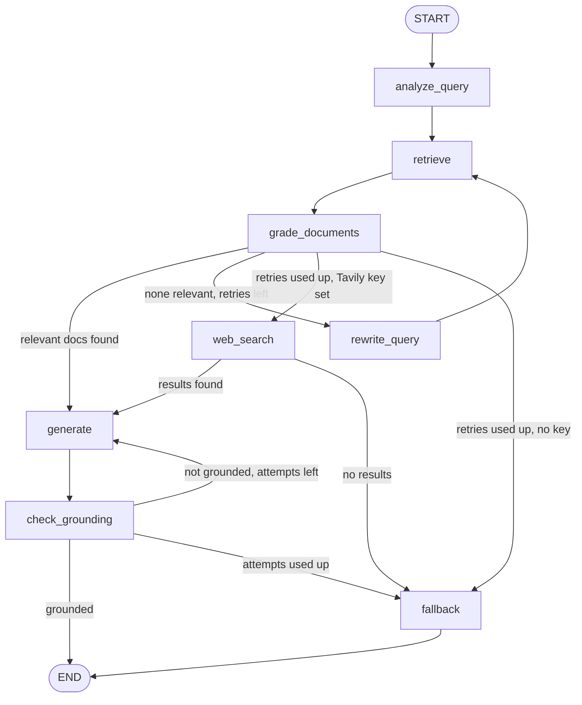

# RAG Technical Documentation Assistant

A Retrieval-Augmented Generation system with a self-corrective LangGraph workflow, served via FastAPI.
Corpus: 5 pages of the official FastAPI tutorial (fetched by script).

Features: query rewriting + classification · Chroma vector search · LLM document grading ·
query-rewrite retry loop · cited answers · hallucination check (Self-RAG style) · optional web-search fallback ·
session memory · Gradio UI · feedback endpoint · tests + eval script.

## Architecture


| Node | Responsibility |
|---|---|
| `analyze_query` | Rewrites/expands the question for retrieval and classifies its type |
| `retrieve` | Top-k similarity search in ChromaDB, returns chunks + metadata |
| `grade_documents` | LLM keeps only chunks relevant to the **original** question |
| `rewrite_query` | If nothing relevant: new query, `retries += 1`, back to `retrieve` |
| `web_search` | (optional, needs `TAVILY_API_KEY`) Tavily fallback after retries are exhausted |
| `generate` | Answer grounded in relevant chunks with `[n]` citations |
| `check_grounding` | Verifies answer is supported by context; regenerates once, then falls back if still unsupported |
| `fallback` | Returns an honest "I don't know" |

Routing: relevant docs -> generate. None -> rewrite and retry (max 2). Still none -> web search (if key) or "I don't know".

### State schema
`question` (never overwritten) · `rewritten_query` · `query_type` · `documents` (overwritten by the grader) ·
`generation` · `retries` · `gen_attempts` · `grounded` · `used_web_search`.
`retries` lives in state so routing is deterministic and loops are always bounded.

## Setup

Python 3.11 or 3.12.
```bash
git clone <your-repo-url> && cd rag-docs-assistant
python -m venv venv
venv\Scripts\activate          # Mac/Linux: source venv/bin/activate
pip install -r requirements.txt
copy .env.example .env         # Mac/Linux: cp .env.example .env   (then add GROQ_API_KEY)
python scripts/fetch_corpus.py # download corpus into data/docs
python -m app.ingestion        # chunk, embed, store in ChromaDB
uvicorn app.main:app --reload  # API at http://127.0.0.1:8000/docs
python ui.py                   # optional Gradio UI (second terminal)
```
Tests: `pytest` · Evaluation: `python scripts/evaluate.py`

## Example requests

### 1. In-corpus question

```bash
curl -X POST http://127.0.0.1:8000/query -H "Content-Type: application/json" \
  -d '{"question": "How do I declare a path parameter?"}'
```

```json
{
  "answer": "You declare a path parameter by placing its name inside curly braces in the route string and (optionally) adding a type annotation in the endpoint function. For example:\n\n```python\nfrom fastapi import FastAPI\n\napp = FastAPI()\n\n@app.get(\"/items/{item_id}\")\nasync def read_item(item_id):\n    return {\"item_id\": item_id}\n```\n\nHere `{item_id}` in the path makes `item_id` a path parameter, and FastAPI passes its value to the `item_id` argument of the function [1].  \n\nYou can also add a type (e.g., an `Enum`) to the parameter:\n\n```python\nfrom enum import Enum\nfrom fastapi import FastAPI\n\nclass ModelName(str, Enum):\n    alexnet = \"alexnet\"\n    resnet = \"resnet\"\n    lenet = \"lenet\"\n\napp = FastAPI()\n\n@app.get(\"/models/{model_name}\")\nasync def get_model(model_name: ModelName):\n    # …\n    return {\"model_name\": model_name}\n```\n\nIn this case `model_name` is declared as a path parameter with the `ModelName` enum type [3].",
  "sources": [
    {
      "source": "fastapi_path-params.md",
      "section": "Path Parameters { #path-parameters }",
      "snippet": "# Path Parameters { #path-parameters }  \nYou can declare path \"parameters\" or \"variables\" with the same syntax used by Python format strings:  \n```python\nfrom fastapi import FastAPI\n\napp = FastAPI()\n\n"
    },
    {
      "source": "fastapi_path-params.md",
      "section": "Path Parameters { #path-parameters } > Path parameters containing paths { #path-parameters-containing-paths } > Path convertor { #path-convertor }",
      "snippet": "### Path convertor { #path-convertor }  \nUsing an option directly from Starlette you can declare a *path parameter* containing a *path* using a URL like:  \n```\n/files/{file_path:path}\n```  \nIn this ca"
    },
    {
      "source": "fastapi_path-params.md",
      "section": "Path Parameters { #path-parameters } > Predefined values { #predefined-values } > Declare a *path parameter* { #declare-a-path-parameter }",
      "snippet": "### Declare a *path parameter* { #declare-a-path-parameter }  \nThen create a *path parameter* with a type annotation using the enum class you created (`ModelName`):  \n```python\nfrom enum import Enum\n\n"
    }
  ],
  "query_type": "how-to",
  "rewritten_query": "How to declare a path parameter in FastAPI, defining route variable, URL path parameter",
  "retries": 0,
  "grounded": true,
  "used_web_search": false
}
```

### 2. Follow-up question (conversation memory, same `session_id`)

```bash
curl -X POST http://127.0.0.1:8000/query -H "Content-Type: application/json" \
  -d '{"question": "What about adding a type to it?", "session_id": "test1"}'
```

```json
{
  "answer": "Add the type directly in the function signature that handles the route.  \nFastAPI reads the Python type annotation and validates the path value accordingly.\n\n**Example with a built‑in type**\n\n```python\nfrom fastapi import FastAPI\n\napp = FastAPI()\n\n@app.get(\"/items/{item_id}\")\nasync def read_item(item_id: int):          # ← type annotation\n    return {\"item_id\": item_id}\n```\n\n**Example with a custom Enum**\n\n```python\nfrom enum import Enum\nfrom fastapi import FastAPI\n\nclass ModelName(str, Enum):\n    alexnet = \"alexnet\"\n    resnet = \"resnet\"\n    lenet = \"lenet\"\n\napp = FastAPI()\n\n@app.get(\"/models/{model_name}\")\nasync def get_model(model_name: ModelName):  # ← enum type annotation\n    if model_name is ModelName.alexnet:\n        return {\"model_name\": model_name, \"message\": \"Deep Learning FTW!\"}\n    if model_name.value == \"lenet\":\n        return {\"model_name\": model_name, \"message\": \"LeCNN all the images\"}\n    return {\"model_name\": model_name, \"message\": \"Have some residuals\"}\n```\n\nIn both cases the type annotation (`int`, `ModelName`, etc.) is placed after the path‑parameter name in the endpoint function definition. This gives you editor support, validation, and automatic documentation.  \n\nSources: [1], [2]",
  "sources": [
    {
      "source": "fastapi_path-params.md",
      "section": "Path Parameters { #path-parameters } > Path parameters with types { #path-parameters-with-types }",
      "snippet": "## Path parameters with types { #path-parameters-with-types }  \nYou can declare the type of a path parameter in the function, using standard Python type annotations:  \n```python\nfrom fastapi import Fa"
    },
    {
      "source": "fastapi_path-params.md",
      "section": "Path Parameters { #path-parameters } > Predefined values { #predefined-values } > Declare a *path parameter* { #declare-a-path-parameter }",
      "snippet": "### Declare a *path parameter* { #declare-a-path-parameter }  \nThen create a *path parameter* with a type annotation using the enum class you created (`ModelName`):  \n```python\nfrom enum import Enum\n\n"
    }
  ],
  "query_type": "how-to",
  "rewritten_query": "How to add a type annotation to a FastAPI path parameter, specifying parameter type",
  "retries": 0,
  "grounded": true,
  "used_web_search": false
}
```

### 3. Out-of-corpus question (retries twice, then "I don't know")

```bash
curl -X POST http://127.0.0.1:8000/query -H "Content-Type: application/json" \
  -d '{"question": "How do I bake sourdough bread?"}'
```

```json
{
  "answer": "I don't know based on the indexed documentation. Try rephrasing your question or ingest more relevant documents.",
  "sources": [],
  "query_type": "how-to",
  "rewritten_query": "sourdough bread recipe with detailed instructions and baking times",
  "retries": 2,
  "grounded": true,
  "used_web_search": false
}
```

Other endpoints: `POST /ingest` (file upload or `url` form field), `GET /documents`, `POST /feedback`, `GET /health`.
## Design decisions & tradeoffs

- Chunking: split by Markdown headers first (keeps sections intact, gives header path for citations), then
  `RecursiveCharacterTextSplitter` with 800 chars / 100 overlap, preferring to break at code-fence boundaries.
  800 chars is small enough for precise retrieval with MiniLM (256-token limit), overlap protects boundary context.
  Tradeoff: very long code blocks can still be split.
- Embeddings: `all-MiniLM-L6-v2` locally: free, fast, no extra key. Tradeoff: weaker than larger/API models.
- Vector store: ChromaDB, persistent, simple, supports metadata filtering (used for dedupe by source).
- Grading: all chunks graded in one structured-output LLM call. Cheaper and rate-limit friendly vs one call per
  chunk; tradeoff is slightly less isolated judgement per chunk. Grader compares against the original question,
  not the rewritten query, to avoid drift.
- Structured output (Pydantic) for analysis, grading and grounding instead of fragile string parsing.
- Retry limit = 2 prevents infinite loops and bounds latency/cost. Grounding regeneration is capped at 2 attempts.
- Sources come from graded chunk metadata, never from LLM text, so citations always match real chunks.
- Memory: in-memory dict per `session_id`; follow-ups are condensed into standalone questions before the graph runs.

## Assumptions
English docs, Markdown/text only, single collection, UTF-8 files, single-process deployment.

## Known limitations
- Session memory is not persistent across restarts or shared across workers. Feedback is persisted in a local JSONL file and is not designed for multi-worker use.
- Query-type classification is recorded but only lightly used downstream.
- Dense-only retrieval; exact identifiers (e.g. specific parameter names) can be missed.
- Grounding check is LLM-based and can itself be wrong.
- Sync endpoints; no auth or rate limiting.
- My first eval set had a question about running the app with uvicorn. The corpus only mentions uvicorn in sample log output, so the system correctly answered "I don't know". I corrected the test, not the system.
- The LLM-based grounding check can be stricter than an answer deserves; after repeated failures the system returns a fallback with grounded=false.
- Query analysis falls back to the raw question if the structured-output call fails (this happened when the model refused an off-topic question).
- The retriever searches with both the rewritten and the original question, then merges and dedupes, because LLM rewrites sometimes drifted from the user's intent.
- The Groq model is configurable through GROQ_MODEL, because my first choice was removed from Groq's catalog.

## What I would improve with more time
Hybrid search (BM25 + vectors) · cross-encoder reranker · parallel/async grading · streaming responses ·
RAGAS evaluation · Docker · persistent session/feedback DB · use `query_type` to tune retrieval (e.g. more chunks for
conceptual questions) · auth and rate limiting.

## Evaluation

Run `python scripts/evaluate.py` after indexing the corpus and configuring a Groq API key. It checks ten example questions, but its keyword-based checks are only a smoke test; review answer quality and citations manually as well. Results depend on the model and the current corpus.
